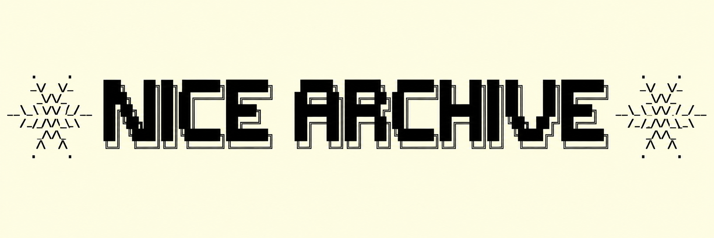
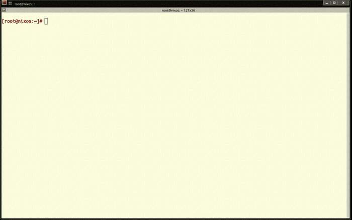
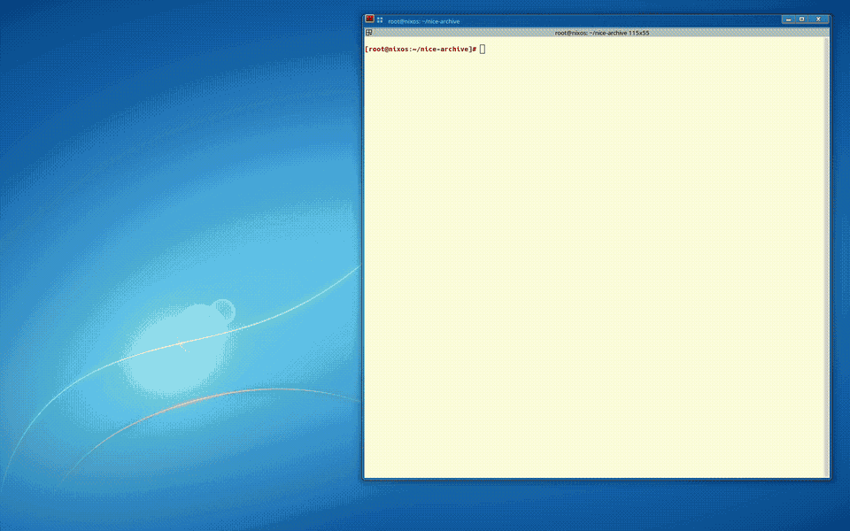

<p align="center">
  
</p>

*Pronounced like the city of Nice, France.*

**NICE Archive** is a collection of vulnerability reproduction recipes. Each recipe provides virtual machine (VM) configurations and an exploitation scenario for a specific CVE.

These recipes are designed to be reproducible, declarative, and machine-checkable. For the design principles and motivation behind NICE Archive, see the [NICE paper](https://arxiv.org/abs/2606.00625).

The project also provides a command-line interface (CLI), `nice-archive`, and a helper library under [`src/`](./src/).

## Requirements

NICE Archive is designed to run on Linux systems. It requires:

- [Nix](https://nixos.org/download.html).
- Nix flakes enabled. Add the following to `/etc/nix/nix.conf`:

  ```ini
  experimental-features = nix-command flakes
  ```

- KVM acceleration (recommended for better VM performance).
- Optionally, [direnv](https://direnv.net/) with nix-direnv for automatic development shell activation.

## Development shell

NICE Archive provides a development environment containing the packages and dependencies needed to build and run its recipes and tools. To enter the development shell, run:

```bash
nix develop
```

To automatically activate the development shell when entering the repository directory, use `direnv` with the provided `.envrc` file:

```bash
cd /path/to/nice-archive
direnv allow
```

## Getting started

#### Demo

<p align="left">
  
</p>
The easiest way to get started is through the CLI's interactive mode. Launch the interactive helper with:

```bash
nice-archive start
```

The interactive menu provides access to the main CLI features:

```text
? What would you like to do? (Use arrow keys)
  → Start interactive scenario
    Run tests
    Run standalone VM machines
    Update flakes for CVE cases
    Report CVE line counts
    Clean generated case artifacts
    Exit
```

Most CLI functionality is accessible through this menu. You can:

- Start an interactive scenario to explore a vulnerable environment.
- Run automated validation tests.
- Launch standalone VMs.
- Update flake locks for CVE cases.
- Count lines in case VM definitions and tests.
- Remove generated logs and VM artifacts from cases.

If you are outside the development shell, replace `nice-archive` with `nix run . --` when running commands from the repository root.

### Run validation tests

CVE cases include validation tests that simulate the exploitation process step by step. These tests use the [NixOS test framework](https://nixos.org/manual/nixos/stable/index.html#sec-nixos-tests), which provides a Python-based interface for controlling and interacting with VMs.

Typically, each test has two variants: one targeting the vulnerable environment and another targeting the fixed environment. Both variants can be executed using the CLI.

To list all available CVE cases:

```bash
$ nice-archive list-cves
cve-2014-0160-heartbleed
cve-2014-0224-early-ccs
cve-2016-5195-dirty-cow
```

Run the vulnerable variant of the Heartbleed test:

```bash
nice-archive test \
  --case cve-2014-0160-heartbleed \
  --vulnerable true
```

Run the fixed (non-vulnerable) variant:

```bash
nice-archive test \
  --case cve-2014-0160-heartbleed \
  --vulnerable false
```

Run all vulnerable tests:

```bash
nice-archive test --all --vulnerable true
```

By default, the CLI saves the full test log in the corresponding CVE case directory and displays only the last 100 lines in the terminal.

You can customize this behavior. For example:

```bash
# Save the full log to a custom filename inside the case directory.
nice-archive test --case cve-2014-0160-heartbleed --log file debug.log

# Stream the test output directly to the terminal without creating a log file.
nice-archive test --case cve-2014-0160-heartbleed --log live
```

See the [CLI tool documentation](./docs/cli-tool.md) for more details.

### Scenario mode

#### Demo
<p align="left">
  
</p>

The NICE Archive CLI provides an interactive debugging mode, called *scenario mode*, that launches all VMs involved in a CVE case and allows users to interact with them directly.

To start a scenario:

```bash
nice-archive scenario \
  --case cve-2020-7247-opensmtpd \
  --vulnerable true \
  --popup true
```

This launches an interactive CPython session with the scenario loaded and all VMs started. Terminal windows also open for interacting directly with the individual VMs.

<!-- TODO: Add a GIF demonstrating scenario mode. -->

By default, VM terminal windows open automatically. You can disable them with `--popup false` and interact with the VMs exclusively through the scenario's Python terminal.

Scenario mode uses the Python interface provided by the [NixOS test framework](https://nixos.org/manual/nixos/stable/index.html#sec-nixos-tests). Some commonly used commands include:

```python
# Start all VMs.
start_all()

# Wait for the server to finish booting.
server.wait_for_unit("multi-user.target")

# Execute a command on the server and require it to succeed.
server.succeed("id")

# Inspect logs for a systemd service.
server.succeed("journalctl -u <unit> --no-pager")
```

To exit the scenario, press `Ctrl+D` in the Python terminal and choose to terminate the VMs. Only one scenario can run at a time.

**Note:** The `test` and `scenario` commands automatically execute `git add <case-dir>` before evaluating flake outputs. This ensures that newly created files are visible to Nix's Git-backed flake evaluation. Be aware that this stages files in Git; review `git status` before committing.

### Update flake locks

Each CVE case uses a flake lock file to pin its dependencies, including Nixpkgs revisions. These locks help preserve reproducibility across executions.

When necessary, you can update the flake lock files using the CLI:

```bash
# Update a specific CVE case.
nice-archive update-flakes --case cve-2014-0160-heartbleed

# Update all CVE cases.
nice-archive update-flakes --all
```

**Note:** Updating flake locks may change the dependencies or behavior of vulnerable environments. Review and validate affected recipes after updating their locks.

## Documentation

For more detailed information, see the [documentation index](./docs/README.md), which includes getting-started guides, CLI documentation, and technical references for the NICE Archive framework.

## Agent-based CVE reproduction

NICE Archive also supports agent-assisted vulnerability reproduction.

The repository provides [`AGENTS.md`](./AGENTS.md), which serves as the entry point and operating contract for LLM-based coding agents.

Given a task such as `Reproduce CVE-YYYY-NNNN`, an agent is expected to investigate the vulnerability, construct or complete an isolated reproduction environment, and validate the vulnerable and fixed behavior using exploitation evidence and automated test oracles.

The agent instructions define the required safety checks, execution and timeout rules, validation procedures, evidence requirements, and optional subagent workflows.

## Contributing

Contributions are welcome! Whether you want to add a new CVE recipe, improve an existing one, fix bugs, or enhance the documentation, please read our [Contribution Guidelines](./CONTRIBUTING.md) before submitting a pull request.

## License

NICE Archive's original code and documentation are licensed under
the [MIT License](./LICENSE).

Third-party exploits and PoCs retain their respective copyrights
and licensing terms and are not covered by NICE Archive's MIT
license grant. See [LICENSING.md](./LICENSING.md) for details.